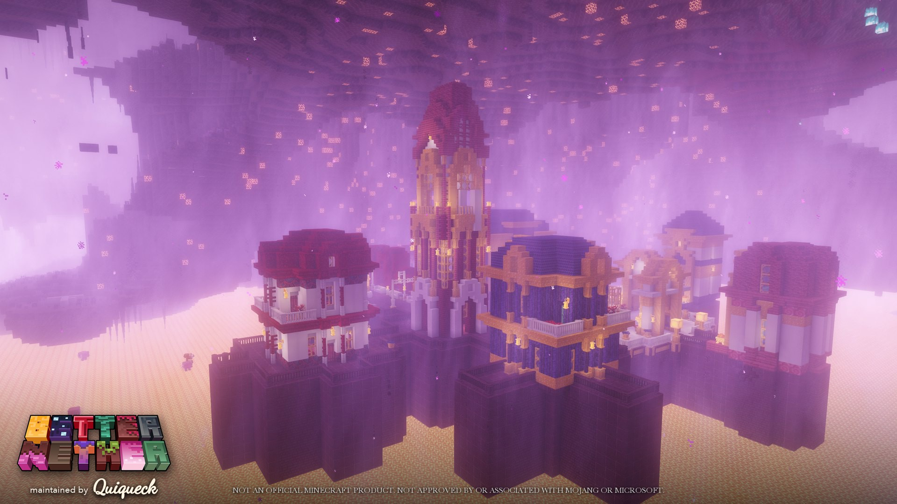
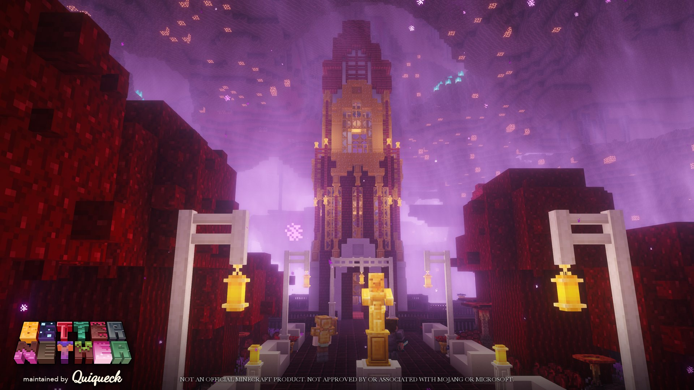
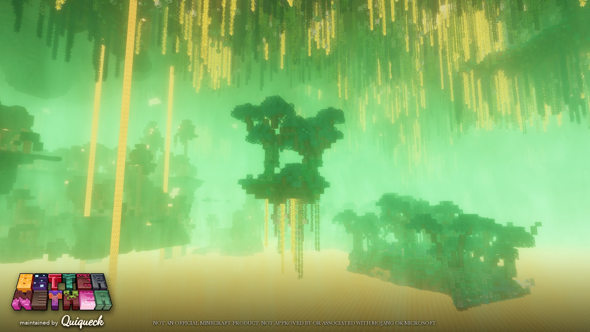
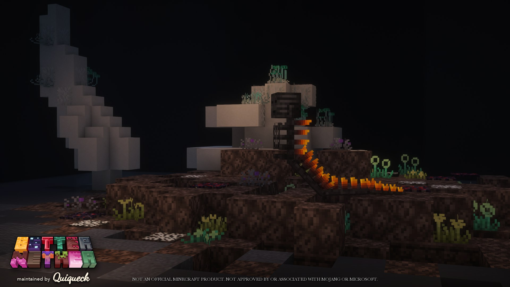
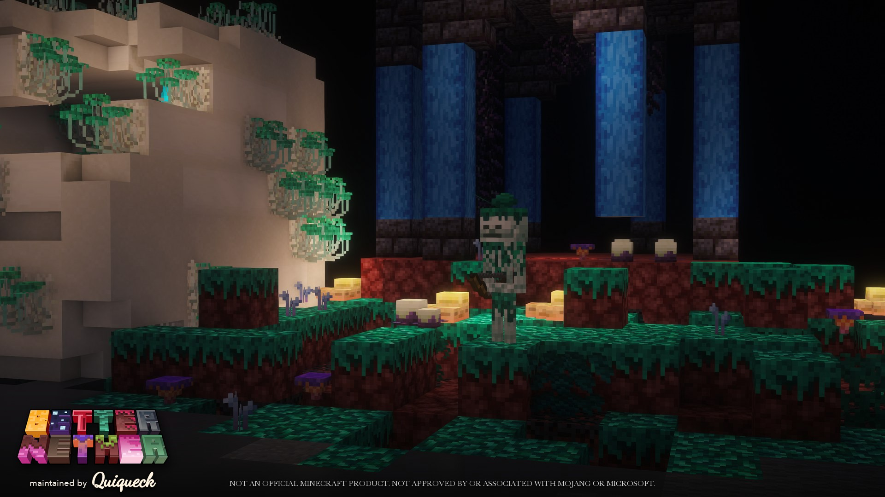
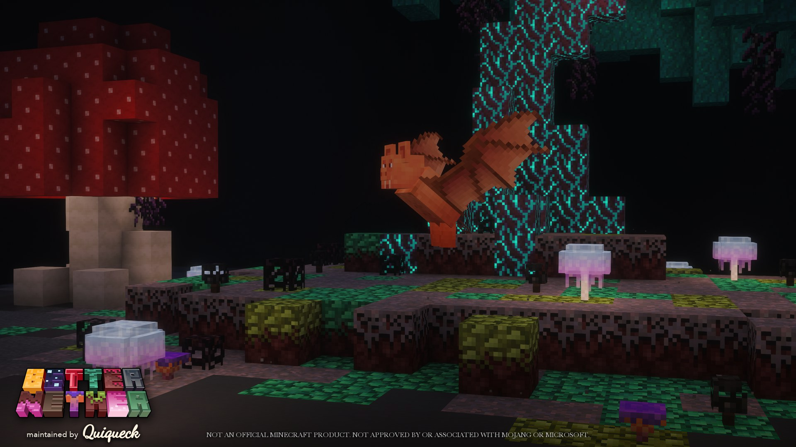
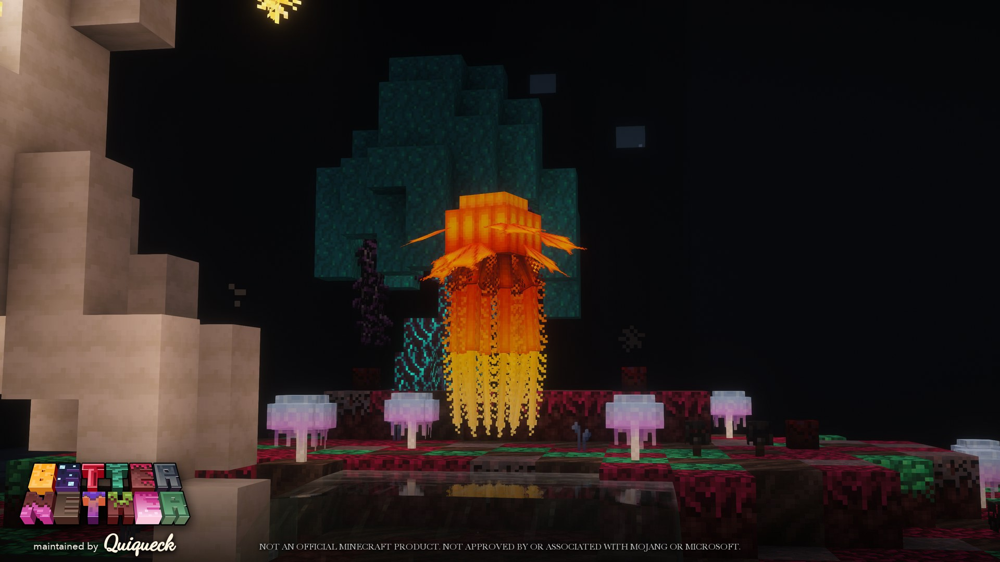
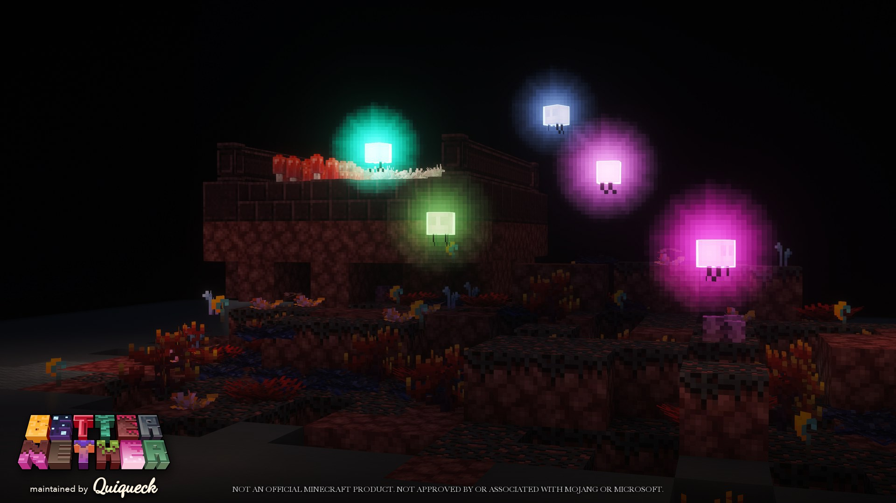
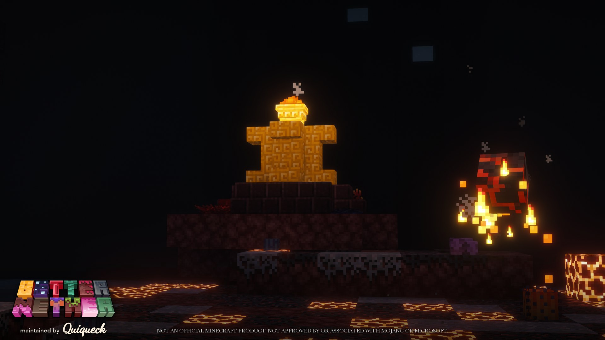

<div align="center">

# BetterNether

**The Nether overhaul for Minecraft (Fabric): new biomes, plants, mobs, structures and tools for the fiery dimension.**

[](https://modrinth.com/mod/betternether)
[](https://www.curseforge.com/minecraft/mc-mods/betternether)
[](https://modrinth.com/mod/betternether/versions)



</div>

**BetterNether** is a Minecraft mod for [Fabric](https://fabricmc.net/) that turns the Nether into a dimension worth
exploring. It adds more than twenty new Nether biomes, dozens of plants and trees, new mobs like the Naga, ruined
dungeons, and the rare, sprawling **Nether Cities**. Builders get new wood types, bricks, tiles and decorations, and
survival players get new tools, armor, food and farmable resources.

This is the official, actively maintained BetterNether repository, developed by [Quiqueck](https://github.com/quiqueck)
and Team BetterX. Releases are published on [Modrinth](https://modrinth.com/mod/betternether) and
[CurseForge](https://www.curseforge.com/minecraft/mc-mods/betternether) for **Minecraft 26.3, 26.2, 26.1,
1.21.6–1.21.8 and 1.20.1**.

## Features

- **New Nether biomes** – Gloomwood, Nether Jungle, Upside Down Forest, Nether Mushroom Forest, Bone Reef,
  Crimson Pinewood, Magma Land, Nether Swampland, Soul Plain, Wart Forest and many more.
- **Vertical biome layers** – biomes are stacked in 3D, so the floor, the open caverns and the ceiling can each look
  different. Works with other Nether mods and datapacks.
- **Structures** – Nether Cities, jungle temples, ghast hives, pyramids, altars, gardens and ruined portals.
- **Plants and farming** – dozens of new plants, trees and mushrooms, many of them farmable.
- **Mobs** – Naga, Jungle Skeletons, Flying Pigs, Hydrogen Jellyfish, Fireflies and Skulls ([see below](#mobs)).
- **Materials and gear** – Cincinnasite, Nether Ruby, new wood sets, tools, armor, weapons and food.
- **Building blocks** – bricks, tiles, roofs, lanterns, furniture and variants of familiar vanilla blocks.
- **Mod integrations** – JEI recipes, Mod Menu config screen, and compatibility with popular world generation mods
  ([see below](#compatibility)).

## Screenshots

| | |
|:-:|:-:|
|  |  |
| *Inside a Nether City* | *Nether Jungle* |

## Mobs

The creatures you will meet in BetterNether's biomes:

| | | |
|:-:|:-:|:-:|
|  |  |  |
| *Naga* | *Jungle Skeleton* | *Flying Pig* |
|  |  |  |
| *Hydrogen Jellyfish* | *Firefly* | *Skull* |

## Download

The latest Fabric release for each supported Minecraft version (the badges update automatically):

| Minecraft | Modrinth | CurseForge |
|:--|:--|:--|
| **26.3** | [](https://modrinth.com/mod/betternether/versions?g=26.3&l=fabric) | [](https://www.curseforge.com/minecraft/mc-mods/betternether/files/all?version=26.3&gameVersionTypeId=4) |
| **26.2** | [](https://modrinth.com/mod/betternether/versions?g=26.2&l=fabric) | [](https://www.curseforge.com/minecraft/mc-mods/betternether/files/all?version=26.2&gameVersionTypeId=4) |
| **26.1 – 26.1.2** | [](https://modrinth.com/mod/betternether/versions?g=26.1.2&l=fabric) | [](https://www.curseforge.com/minecraft/mc-mods/betternether/files/all?version=26.1.2&gameVersionTypeId=4) |
| **1.21.6 – 1.21.8** | [](https://modrinth.com/mod/betternether/versions?g=1.21.8&l=fabric) | [](https://www.curseforge.com/minecraft/mc-mods/betternether/files/all?version=1.21.8&gameVersionTypeId=4) |
| **1.20 – 1.20.1** | [](https://modrinth.com/mod/betternether/versions?g=1.20.1&l=fabric) | [](https://www.curseforge.com/minecraft/mc-mods/betternether/files/all?version=1.20.1&gameVersionTypeId=4) |

**Required:** [Fabric API](https://modrinth.com/mod/fabric-api), [BCLib](https://modrinth.com/mod/bclib) and
[WorldWeaver](https://modrinth.com/mod/worldweaver) (1.21.6 and newer).
**Optional:** [JEI](https://modrinth.com/mod/jei), [Mod Menu](https://modrinth.com/mod/modmenu).

## Compatibility

Every release is validated against popular world generation mods. A dedicated server boots BetterNether with each of
these mods (alone and all together), runs BetterNether's full GameTest suite, and checks that every mod's biomes still
generate in their dimensions, that WorldWeaver's world generator stays in charge, and that BetterNether's surface rules
survive. The results are listed under *Validation* in each release's changelog.

<!-- mod-task:verified:start -->

| Mod | Verified version (Minecraft 26.3) | Get it |
|:--|:--|:--|
| [](https://modrinth.com/mod/biomes-o-plenty) | `26.3.0.0.13` | [](https://modrinth.com/mod/biomes-o-plenty) [](https://www.curseforge.com/minecraft/mc-mods/biomes-o-plenty) |
| [](https://modrinth.com/mod/terralith) | `2.6.5` | [](https://modrinth.com/mod/terralith) [](https://www.curseforge.com/minecraft/mc-mods/terralith) |
| [](https://modrinth.com/mod/incendium) | `5.5.3` | [](https://modrinth.com/mod/incendium) [](https://www.curseforge.com/minecraft/mc-mods/incendium) |
| [](https://modrinth.com/mod/nullscape) | `2.0.1` | [](https://modrinth.com/mod/nullscape) [](https://www.curseforge.com/minecraft/mc-mods/nullscape) |
| [](https://modrinth.com/mod/stellarity) | `6.0.1` | [](https://modrinth.com/mod/stellarity) [](https://www.curseforge.com/minecraft/mc-mods/stellarity) |

<!-- mod-task:verified:end -->

## You might also like

- [**BetterEnd**](https://github.com/quiqueck/BetterEnd) – new biomes, mobs and structures for the End.
- [**Wunderreich**](https://github.com/quiqueck/wunderreich) – vanilla+ mechanics for storage, trading and building.

## Links

- [Wiki](https://modwiki.ambertation.de/#/en/26_1_x/mod/betternether)
- [Issue tracker](https://github.com/quiqueck/BetterNether/issues)

## Building from source

You need JDK 25 for the 26.x branches (JDK 21 for 1.21.x, JDK 17 for 1.20.1).

```bash
git clone https://github.com/quiqueck/BetterNether.git
cd BetterNether
./gradlew build
```

The mod jar is written to `build/libs`.

Each Minecraft version has its own release branch: `release/26.3`, `release/26.2`, `release/26.1`, `release/1.21.6` and `release/1.20` (1.20.1).

## Credits and license

BetterNether was created by paulevs and is maintained by
[Quiqueck](https://github.com/quiqueck) and Team BetterX since 2022. Building help and design by edos_,
buildings and art by GustlGo, buildings by Elixy. The original repository is archived; all development
happens here.

The source code is licensed under the [MIT License](LICENSE).

**Assets (2026-10-30).** Assets (textures, images, models, music and sounds) are not covered by the MIT License.
They are governed by [LICENSE.ASSETS](LICENSE.ASSETS), which also lists their authors: unless stated otherwise, they
are All Rights Reserved, and a listed subset is licensed under CC BY-NC-SA 4.0 (attribution: Team BetterX).
As long as they stay unmodified and bundled with the official mod release, you may use them in modpacks and on
servers (commercial and non-commercial ones). You may also show them in videos, streams and screenshots.

## AI Usage

The ideas and the design of BetterNether are human-made: we come up with the concepts, guide every design decision and implement the code. We use agentic AI as a tool for the following tasks:

- tooling and automation,
- code review,
- proofreading and writing documentation (code comments and this README),
- boilerplate work, including migrating the codebase to new Minecraft versions,
- many of our automated tests.

Everything the AI generates is reviewed and, where needed, edited by us before it is released. We also playtest every release ourselves.
